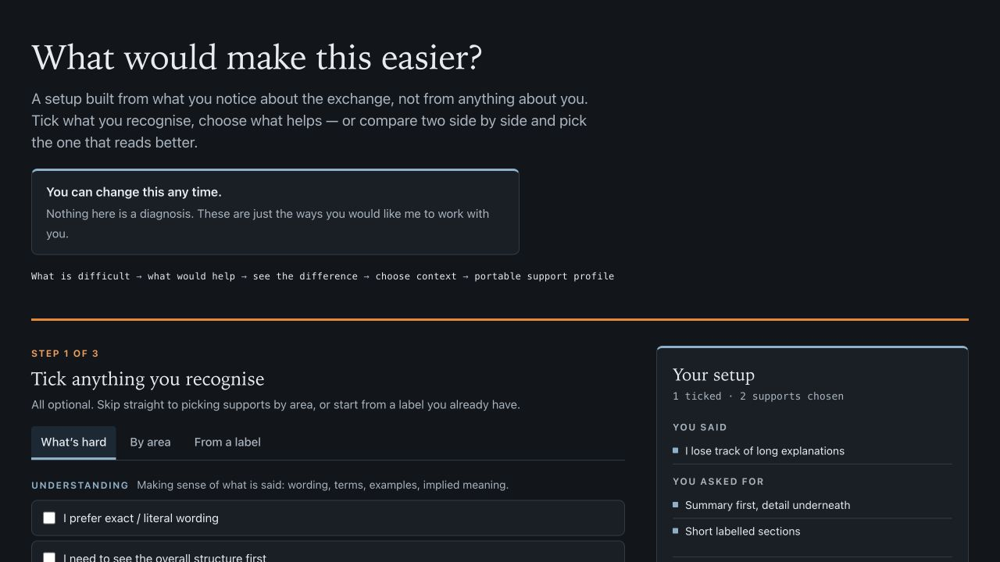

# i-have-neurodivergence

**Make AI replies easier to read, follow and act on—with settings you choose.**

## [Try the live picker →](https://trickaay.github.io/i-have-neurodivergence/)

Choose clearer wording, shorter sections, fewer choices or one step at a time. You do not need a diagnosis, a download or any coding knowledge to get started.

[](https://trickaay.github.io/i-have-neurodivergence/)

*The real picker, with two example supports selected. Every choice is optional and can be changed.*

## Start here: use it in a conversation

1. **[Open the picker](https://trickaay.github.io/i-have-neurodivergence/)**. Tick something you recognise, then choose what helps. “Show me the difference” lets you compare two styles.
2. **Choose “Copy for your agent”**. Leave the format on **“Plain instructions — paste anywhere”**, then press **Copy**.
3. **Paste into a new conversation** with ChatGPT, Claude or another assistant. Add your question underneath.

You can also save the instructions in your assistant's custom-instructions settings, if it has them. If copying does not work, press **Download**, open the text file and copy from there. You can change the wording to suit you.

Want a quick taste? Paste these three lines into a conversation:

```text
Use short, clearly labelled sections and plain, literal language.
For a task, give one concrete next step and say what “done” looks like.
Keep essential warnings and exact details; ask before actions that need permission.
```

## What difference can it make?

These are **illustrative examples**, not recorded test results or promises about every reply. Choose the style that works for you.

| Preference | Without the preference | With the preference |
| --- | --- | --- |
| **Exact, literal wording** | “Give me a shout when you've got the ball rolling.” | “Tell me when you have started.” |
| **One step at a time** | “Open the document, add a title, write your list and save it.” | “Open the document. Done when the document is visible. I'll wait before giving the next step.” |

A support changes how an answer is presented. It does not give the assistant permission to act, remove essential warnings or make decisions for you.

## Install skills

**Installation is optional.** The copy-and-paste route above is enough for ordinary chat. Skills are reusable instructions for tools such as Codex and Claude Code.

[Download the current pack](https://github.com/Trickaay/i-have-neurodivergence/archive/refs/heads/main.zip), then extract the ZIP before using the files. Start with [START_HERE.md](START_HERE.md) inside the folder.

### Codex

The pack has **31 skills** for Codex. For a first manual installation in one project:

1. In the folder you work on in Codex, create `.agents`, then a `skills` folder inside it. [Help with hidden folders](INSTALL.md#choose-where-the-skills-apply).
2. In the extracted pack, open `platforms/codex/skills/`.
3. **Check for same-name folders in your destination before copying.** If any exist, stop and follow the [update instructions](INSTALL.md#update-or-remove); do not replace or merge them.
4. Copy the **31 complete folders inside** the pack's `skills` folder into your project's `.agents/skills/`. Keep their contents and subfolders together.
5. Open the project in a **new Codex chat** and choose **needs-picker** from the skill menu. In the CLI or IDE extension, type `$needs-picker`.

For installation with ownership records and recoverable removal, use the [recorded installer](INSTALL.md#recorded-installation-and-removal-recommended). It requires Python 3.10 or later. Keep the exact installation record for removal; asking an agent to find the “latest” installation is not a supported shortcut. An agent with access to your local files can follow [INSTALL_WITH_AGENT.md](INSTALL_WITH_AGENT.md); an uploaded ZIP alone does not grant that access.

### Claude Code

For the **19-skill marketplace plugin**, paste these commands **inside an interactive Claude Code session**, one at a time:

```text
/plugin marketplace add Trickaay/i-have-neurodivergence
/plugin install i-have-neurodivergence@i-have-neurodivergence
```

Choose the installation scope Claude Code offers. Restart if needed, then type:

```text
/i-have-neurodivergence:needs-picker
```

Want **all 31 skills**, including the area-based skills? From the extracted pack folder, run this in a terminal:

```sh
claude --plugin-dir "platforms/claude"
```

Then use `/what-would-make-this-easier-skills:needs-picker` in that session. Keep the extracted folder and use the launch command each time. Python is not needed. [Full Claude Code instructions, including updates and removal](INSTALL.md#claude-code).

**Claude chat and ChatGPT:** use the browser picker instructions above; these Claude Code commands are for the coding application.

## Make it your own

- Start from what is difficult, browse by area, or use a condition or trait preset. No label is required.
- Choose when a support applies—for example, only at work or when learning something new.
- Keep an editable copy by choosing **Support profile (YAML)** and pressing **Download**. The JSON export contains compiled instructions, not the editable difficulty selections.
- To use the picker offline, open `needs-picker.html` from the extracted pack in your browser.
- Keep personal notes private. Exported instructions and profiles include any notes you add.

The pack includes 89 supports across 12 areas: understanding, information load, attention, planning, memory, learning, communication, sensory access, choice, transitions, motor interaction and pacing. The full platform packs contain 19 authored skills plus 12 area skills. [Browse the skills and other platforms](platforms/README.md).

## Validation status

This is **early-access software**. Preferences can help express what you want, but an assistant may still ignore or misapply them. The rules have not been validated as treatments or as effective support for everyone.

The current source is **0.4.9**. See [validation results and remaining limits](VALIDATION.md), [release notes](RELEASE_NOTES.md), and [installation help](INSTALL.md). The older [0.4.5 release](https://github.com/Trickaay/i-have-neurodivergence/releases/tag/v0.4.5) remains available; use the current-pack link above for the newer source.

The browser picker needs no Python or build step. Agents without usable file tools cannot install it for you. Cowork and Hermes host integrations remain unqualified. If exact export bytes matter, use Download: manual selection can omit the final line break.

## Inspiration and license

Inspired by [ayghri/i-have-adhd](https://github.com/ayghri/i-have-adhd), whose skill format provided the starting point. This pack builds on that idea with a needs-based picker, individually chosen supports and exports for different assistants.

Released under the [MIT License](LICENSE). See [third-party notices](THIRD_PARTY_NOTICES.md). For commands, builds and tests, see the [development guide](DEVELOPMENT.md).
