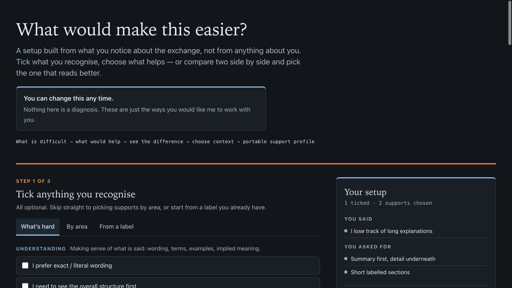

# i-have-neurodivergence

[](https://trickaay.github.io/i-have-neurodivergence/)

**Make AI replies easier to read, follow and act on—with settings you choose.**

**[Try the live picker →](https://trickaay.github.io/i-have-neurodivergence/)** · [Download current source](https://github.com/Trickaay/i-have-neurodivergence/archive/refs/heads/main.zip) · [Install with an agent](INSTALL_WITH_AGENT.md)

Choose shorter sections, clearer wording, fewer choices or concrete steps. Copy the result into your assistant. No download, diagnosis or compiler needed to try the picker.

## Quick start: try three lines

Paste this into a ChatGPT or Claude conversation, or your custom instructions, then ask your usual question:

```text
Use short, clearly labelled sections and plain, literal language.
For a task, give one concrete next step and say what “done” looks like.
Keep essential warnings and exact details; ask before actions that need permission.
```

These are example preferences: change or remove any line. For your own combination, [open the picker](https://trickaay.github.io/i-have-neurodivergence/).

The pack includes **19 authored skills**, **89 supports** across **12 areas**, and **31 skills per generated platform**. You can change or stop the settings at any time.

## Get the pack

The current source is **0.4.6**, with repairs from the 0.4.5 retest. [Download current source](https://github.com/Trickaay/i-have-neurodivergence/archive/refs/heads/main.zip), extract it, and open [START_HERE.md](START_HERE.md). It includes the [installation guide](INSTALL.md) and [agent-install recipe](INSTALL_WITH_AGENT.md). GitHub's source ZIP has no `BUNDLE_MANIFEST.json`; an installing agent must establish its source before copying.

The original [0.4.5 early-access release](https://github.com/Trickaay/i-have-neurodivergence/releases/tag/v0.4.5) remains available unchanged. Its curated ZIP contains a manifest, but predates the current skill and safe-removal guidance. The live picker and marketplace follow current source. See [release notes and limits](RELEASE_NOTES.md).

## Start with the picker

1. [Open the live picker](https://trickaay.github.io/i-have-neurodivergence/).
2. For offline use, download and extract the [current source ZIP](https://github.com/Trickaay/i-have-neurodivergence/archive/refs/heads/main.zip), then open `needs-picker.html` in your browser.
3. Choose what would make the exchange easier, then choose what helps. Everything is optional.
4. Copy the **Plain instructions** output into your assistant's custom instructions or the start of a conversation.

The picker also exports an `AGENTS.md` section, a `SKILL.md`, YAML and JSON. YAML is the editable profile and preserves your difficulty selections. JSON contains compiled supports and rules; it omits structured difficulty selections, while retaining any notes you supplied. To keep an editable profile, export YAML and save it as `needs.yaml` wherever you choose. The browser page does not require a Python installation or a build step.

If clipboard access is blocked, Copy selects the displayed text for manual copying. Some browsers omit its final line break from that selection. Download preserves the complete export, including its final line break.

## Install skills

In an interactive Claude Code session, add this repository as a marketplace and install the plugin:

```text
/plugin marketplace add Trickaay/i-have-neurodivergence
/plugin install i-have-neurodivergence@i-have-neurodivergence
```

Restart the host if needed, then invoke `needs-picker` using its skill menu or command; in Claude Code it is listed as `/i-have-neurodivergence:needs-picker`. The root plugin contains the 19 authored skills. The generated Claude platform plugin also includes the 12 area skills; see the [platform installation guide](platforms/README.md#claude-code-and-cowork).

For an existing Claude Code installation, refresh the marketplace and update the plugin, then restart the host:

```text
/plugin marketplace update i-have-neurodivergence
/plugin update i-have-neurodivergence@i-have-neurodivergence
```

For a terminal or coding agent, use the CLI form with the intended scope. This example uses project scope:

```bash
claude plugin marketplace add Trickaay/i-have-neurodivergence --scope project
claude plugin install i-have-neurodivergence@i-have-neurodivergence --scope project
```

The [installation guide](INSTALL.md) also gives the CLI update commands. `/plugin` commands require an interactive Claude session; they are not commands for `claude -p`.

The current marketplace version is **0.4.6**. Earlier repaired files still used the `0.4.0` version, which caused existing installations to keep their cached copy. Updating the marketplace alone does not update the installed plugin.

For **Codex**, follow the [Codex installation steps](INSTALL.md#codex) to copy all 31 complete folders from `platforms/codex/skills/` into your project's `.agents/skills/` or your personal `~/.agents/skills/`. Open that project in Codex and select `needs-picker` from the skill picker; in the CLI or IDE extension, type `$needs-picker`.

For **Hermes Agent**, use the skill folders and bundles under `platforms/hermes/`. For any other assistant, use the picker output or a block from `platforms/universal/`.

See the [platform installation guide](platforms/README.md) for paths, commands and format details. Copy complete skill folders, including the picker's bundled references, compact menu and compiler.

## Choose a skill directly

The authored skills include the picker, two task-focused skills, and 16 condition or trait presets:

| Purpose | Skills |
| --- | --- |
| Choose your own supports | `needs-picker` |
| Learning and communication | `help-me-learn-this`, `help-me-with-words` |
| Wording and information | `i-have-autism`, `i-have-dyslexia`, `i-have-dyscalculia`, `i-have-apd` |
| Action and input | `i-have-dyspraxia`, `i-have-dysgraphia`, `i-have-tics` |
| Memory, starting and pacing | `i-have-working-memory-differences`, `i-have-inertia`, `i-have-limited-energy`, `i-need-low-demand` |
| Internal references | `i-have-alexithymia`, `i-have-aphantasia` |
| Sensory and assistive technology | `i-have-sensory-sensitivity`, `i-use-a-screen-reader`, `i-have-colour-vision-deficiency` |

The generated `easier-<area>` skills offer supports without a condition label: understanding, information load, attention, planning, memory, learning, communication, sensory access, choice, transitions, motor interaction and pacing.

Skills can be combined. Each support skill documents its stop phrase; the picker produces a profile and then stops. When preferences conflict, follow safety and host constraints, then what the reader can perceive, act on and understand. Ask the reader to resolve conflicts between their own settings. Presentation preferences never grant permission or replace a required confirmation.

## Profiles and evidence

No diagnosis is required. The picker stores chosen supports, contexts, reported difficulties and optional notes; it does not infer a condition or retain a preset label. Notes contain whatever you choose to write, including any personal information you include. Keep, edit or delete your exported profile yourself.

Each support includes an evidence record separating the underlying difficulty, the presentation or teaching method, and the exact rule. **Evidence for a difficulty is not proof that a prompt rule helps. The exact rules have not been validated for effectiveness in an agent.** The picker's “Why is this offered?” view explains these distinctions. Defaults are starting points you can change.

## Command-line use

The compiler uses Python's standard library:

```bash
python3 needs/compile.py needs.yaml
python3 needs/compile.py needs.yaml --format agents
python3 needs/compile.py needs.yaml --format skill
python3 needs/compile.py needs.yaml --format codex
python3 needs/compile.py needs.yaml --format hermes
```

Run these from the repository root, with the path to your own profile. The [needs model](needs/NEEDS_MODEL.md) describes the data and exports.

## Development and validation

Edit the authored skills, `needs/needs-vocabulary.json`, `needs/picker.template.html` or `platforms/adaptations.json`, then regenerate derived files:

```bash
python3 needs/build.py
python3 platforms/build_platform_skills.py
```

The same build writes `docs/index.html` as an exact copy of `needs-picker.html`. GitHub Pages publishes `main` → `/docs`; `needs/build.py --check` detects a stale live-page copy. Published release ZIPs and tags stay fixed; current source and the live picker can contain newer repairs.

Before publishing changed skills, increase the version in `.claude-plugin/plugin.json`. The platform generator reads that version for every generated bundle; keeping the old version prevents existing Claude installations from receiving the update.

Available checks:

```bash
python3 needs/build.py --check
python3 needs/parity_check.py
python3 needs/compile.py --self-test
python3 needs/rule_checks.py
python3 needs/conformance_test.py
python3 platforms/build_platform_skills.py --check
python3 platforms/validate_platforms.py
```

Browser conformance needs Playwright and Chromium; missing Playwright reports a skip, while a missing browser executable must be installed or selected with `CHROMIUM_PATH`. Platform validation needs PyYAML, and uses `skills-ref` when installed.

### Validation status

These are smoke checks of files, the browser page and live sessions. **They do not establish support effectiveness, identical responses between sessions, or complete assistive-technology coverage.**

**Returned Claude retest of 0.4.5.** The 66 fixed turns scored 56 PASS and 10 FAIL. Six new wording controls and six save turns passed; picker journeys scored 13 PASS and one FAIL. Agent-assisted installation had five passing cases, five failing cases and one hung attempt recorded as NOT_RUN. Independent review checked the raw responses, reviewer records, source identities and file effects. The reported release download, fresh installs and public plugin upgrade passed; Chromium browser failures were the known manual-selection final-newline limitation.

**Current repairs (0.4.6).** Planning gives a reason within the first step; numeric tables distinguish duration, clock time and ratios; overview counts agree with the actual parts; the picker menu omits unsolicited preset labels. Agent installation saves a durable inventory, and removal stops on edited, extra, missing or symlinked entries. Instructions distinguish interactive and CLI commands and include both bundled-plugin launch forms.

**Verification.** Fresh Codex sessions scored 39 PASS and 5 UNKNOWN across 44 counted turns; all 44 final answers met the tested contracts, while five picker turns had extra host commentary whose priority could not be established. One harness-invalid session was retained and excluded. All 31 skills were discovered. Installation and removal checks preserved unrelated and pre-existing skills and stopped without changes on customized or extra files. Six static checks, both Claude plugin manifests and 83 software-DOM checks passed; a native-browser smoke check matched exports to the compiler. Native clipboard readback remained UNKNOWN. A genuine Claude CLI upgrade from 0.4.5 to 0.4.6 passed against an isolated local Git fixture, with all 206 installed source files matching; public update transport was not rerun for this candidate. A source-archive installation without a bundle manifest also retained verified provenance and copied all 31 folders exactly. These are bounded smoke checks, not a guarantee that models always follow the rules. Fresh Claude behavior for 0.4.6, native Windows installation, Cowork, Hermes and human screen-reader use remain unverified. A tool-restricted instruction test is not a reproduction of a tool-less Claude host. Host-required skill announcements can affect exact-screen checks; uncertain provenance stays UNKNOWN.

**Browser limits.** The browser's logic, layout and styling are unchanged; embedded support wording is regenerated. Software-DOM checks do not establish native clipboard or accessibility behavior. Manual selection may omit the final newline; use Download when exact bytes matter. The nonblocking missing-icon directory warning remains.

## Inspiration and license

Inspired by [ayghri/i-have-adhd](https://github.com/ayghri/i-have-adhd), whose skill format provided the starting point for this collection.

Released under the [MIT License](LICENSE). See [third-party notices](THIRD_PARTY_NOTICES.md) for upstream attribution.
